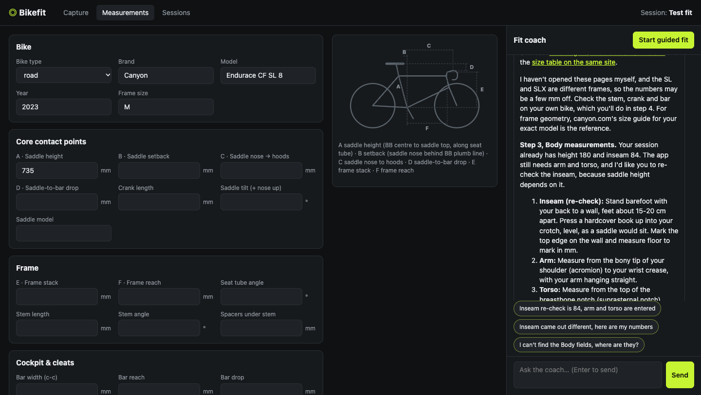

# Bikefit

A local bike-fit studio for your Mac: camera pose tracking, a measurement log, and Claude as your fit coach.



## What it does

- **Capture**: live joint angles from your webcam, iPhone (Continuity Camera), or a recorded video or photo. Record 10 seconds of pedalling to get knee, hip, torso, elbow and shoulder ranges, checked against road-fit targets. Freeze a frame to drag joints into place and save a snapshot.
- **Measurements**: bike identity, contact points, frame geometry, cockpit, cleats, and body, with a labelled diagram.
- **Sessions**: every change you make becomes a session. Compare any two side by side with deltas.
- **Fit coach**: a guided, step-by-step fit in chat, from intake to a verified position. The coach reads your sessions and snapshots, looks up your bike model's geometry on the web, and suggests the next step as one-click options.

## Requirements

- macOS with Python 3.10+ (no packages to install)
- [Claude Code](https://claude.com/claude-code), installed and logged in. The coach runs through it, so no API key is needed.
- Chrome or Safari, with internet on first load for the pose model

## Quick start

```sh
git clone https://github.com/ryan-ott/bikefit.git
cd bikefit
python3 server.py
```

Open http://localhost:8765 and press **Start guided fit**.

For capture, put the bike on a trainer and the camera level with your hip, square to the side of the bike, with your whole body in frame.

## Configuration

| Variable | Default | |
|---|---|---|
| `BIKEFIT_DATA` | `./data` | Where sessions are stored. Point it at an iCloud Drive folder to share sessions between Macs. |
| `BIKEFIT_MODEL` | `sonnet` | Coach model (`haiku`, `sonnet`, `opus`) |
| `BIKEFIT_PORT` | `8765` | |

## Privacy

Everything stays on your machine. The server only listens on localhost, `data/` is git-ignored, and the coach can only read files and search the web.

## Tests

```sh
python3 -m unittest test_server && node --test angles.test.mjs
```

## Disclaimer

The target ranges are common starting points and do not replace a professional fit. If you have persistent pain or numbness, see a fitter or physio.

## License

MIT
